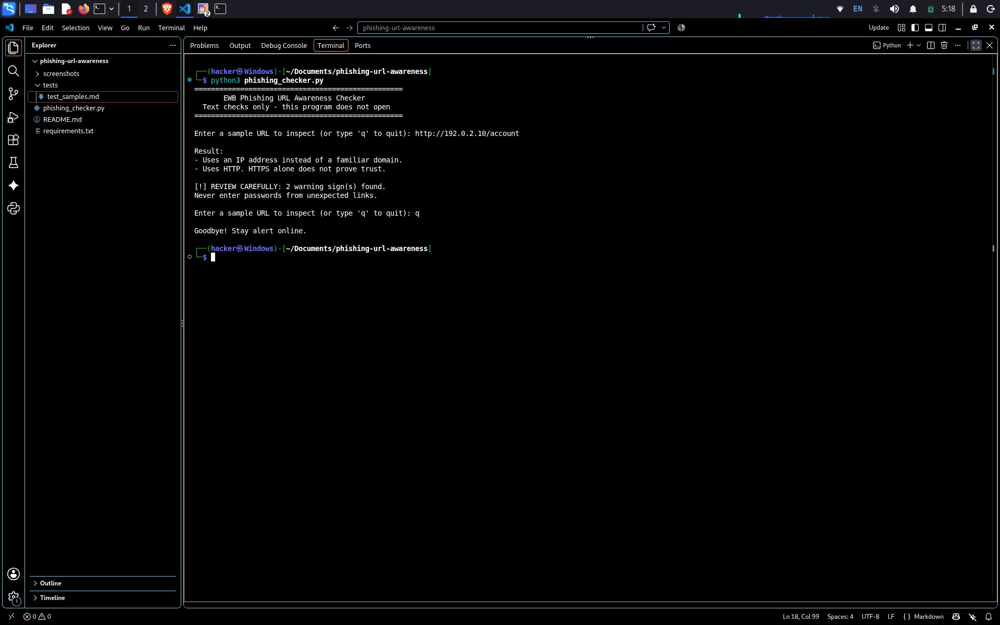
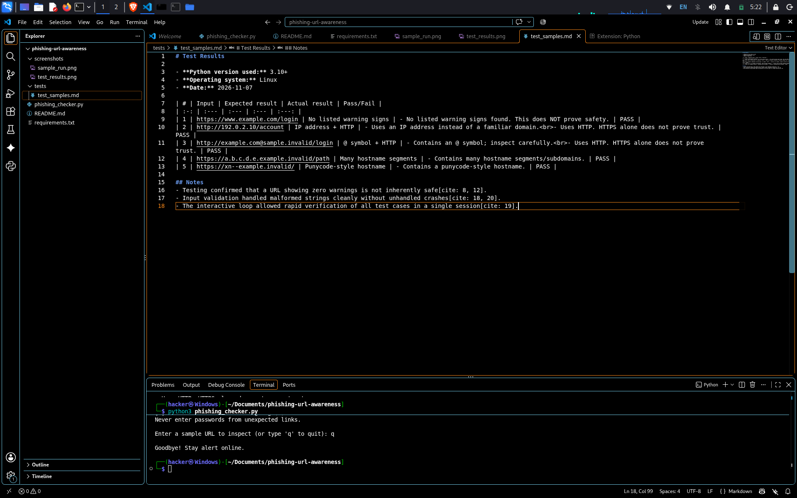

# EWB Phishing URL Awareness Checker[cite: 20]

## Overview[cite: 20]
Phishing is a social engineering attack where malicious actors use deceptive links to trick victims into disclosing sensitive credentials, session tokens, or personal data[cite: 8]. The EWB Phishing URL Awareness Checker is a Python security utility designed to inspect the visible plaintext structure of a URL for common structural anomalies without ever connecting to or resolving the web address[cite: 8].

## Features[cite: 20]
- Detects the presence of an `@` symbol (often used to disguise the true destination domain)[cite: 12, 20].
- Flags long URLs (exceeding 100 characters)[cite: 12, 20].
- Flags hostnames formatted as raw IP addresses rather than registered domain names[cite: 12, 20].
- Identifies deeply nested subdomains (5 or more hostname labels)[cite: 12, 20].
- Identifies Punycode notation (`xn--`) used in IDN homograph attacks[cite: 12, 20].
- Flags unencrypted HTTP connections[cite: 12, 20].
- **Improvement A:** Interactive command-line loop enabling continuous analysis without program restarts[cite: 19, 21].
- **Improvement B:** Summary banner highlighting the exact count of flagged indicators[cite: 19, 21].
- **Improvement C:** Exception handling for malformed bracketed URL inputs preventing system crashes[cite: 18, 19, 20].

## Requirements[cite: 21]
Python 3.10 or later[cite: 8, 21]. Built with standard libraries (`re`, `urllib.parse`)[cite: 12, 15, 21]. No third-party packages required[cite: 15, 21].

## How to Run[cite: 21]
```bash
python3 phishing_checker.py
```[cite: 15, 21]

## Example Output[cite: 21]
```text
==================================================
       EWB Phishing URL Awareness Checker         
  Text checks only - this program does not open   
==================================================

Enter a sample URL to inspect (or type 'q' to quit): [http://192.0.2.10/account](http://192.0.2.10/account)

Result:
- Uses an IP address instead of a familiar domain.
- Uses HTTP. HTTPS alone does not prove trust.

[!] REVIEW CAREFULLY: 2 warning sign(s) found.
Never enter passwords from unexpected links.
```[cite: 15, 20]

## Testing[cite: 21]
| # | Input | Expected | Actual | Result |
| :-: | :--- | :--- | :--- | :-: |
| 1 | https://www.example.com/login | No warning signs | No listed warning signs found | PASS |
| 2 | http://192.0.2.10/account | IP address + HTTP | IP address + HTTP detected | PASS |
| 3 | http://example.com@sample.invalid/login | @ symbol + HTTP | @ symbol + HTTP detected | PASS |
| 4 | https://a.b.c.d.e.example.invalid/path | Many hostname segments | Many hostname segments detected | PASS |
| 5 | https://xn--example.invalid/ | Punycode hostname | Punycode hostname detected | PASS |[cite: 17, 21]

## Screenshots[cite: 21]
[cite: 21]
[cite: 21]

## Improvements[cite: 21]
1. **Interactive Session Loop (`main`):** Integrated a `while True` loop so users can check multiple URLs consecutively without re-launching the script# phishing-Url-awareness
# phishing-Url-awareness
